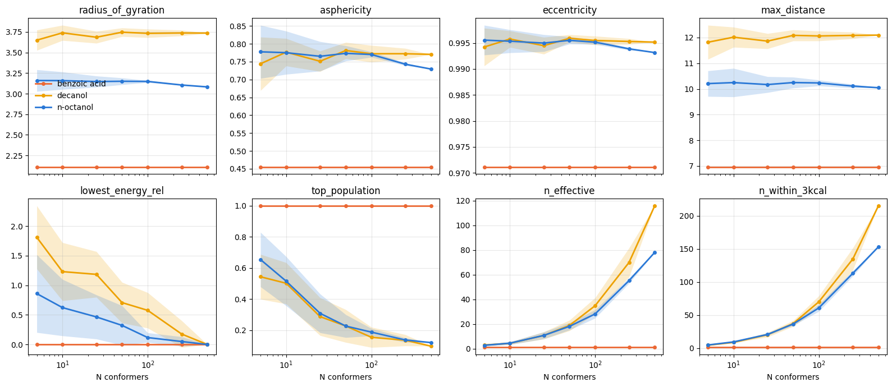
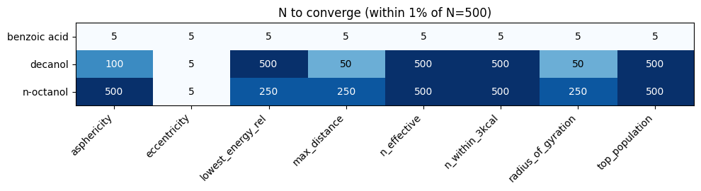

# Conformer sampling convergence: initial results (v0.1.0)

## Question

How many conformers must be generated before Boltzmann-weighted ensemble
properties stop changing?

## Method

- Molecules: benzoic acid (rigid), n-octanol and decanol (flexible chains)
- Pool: 500 conformers per molecule (RDKit ETKDGv3, seed 0), optimized with MMFF94
- Subsampling: N = 5, 10, 25, 50, 100, 250, 500; 10 random draws from 500 conformer pool per N. A converged N of 500 means no convergence within the tested range
- Deduplication within each subset: `RMSDFilter(cutoff=0.5 Å, heavy_atoms_only=True)`,
  keeping the lowest-energy conformer of each group; via EnsembleLab functions
- Boltzmann weights recomputed within each subset at 298.15 K
- Converged: mean stays within 1% of the N = 500 value for all larger N
  (0.1 kcal/mol absolute tolerance for the lowest relative energy)

## Results

**Figure 1.** Mean over 10 random draws (line) ± 1 SD (shaded) for eight metrics vs N, n-octanol

**Figure 2.** N_conformers at convergence of eight metrics for benzoic acid, decanol, and n-octanol.500 = did not converge within the tested range

*Find raw metric processing dataset in experiments/data/results/convergence_study.csv

## Observations

- Rigid molecules (ex. benzoic acid) converge almost immediately; deduplication reduces the N=500 pool to a single conformer. Its conjugated COOH is planar, so freedom is flipping COOH/OH, flips that look identical when comparing heavy atoms with symmetry taken into account.
- Metrics like lowest_energy_rel, n_effective, and top_population for flexible chains (decanol, n-octanol), do not converge by N = 500. Decanol's lowest-energy conformer was still being found between N = 250 and 500 (0.18 kcal/mol above final minimum at N = 250), and effective ensemble size keeps growing. This means the 500 conformer count as a maximum sample size is likely ineffective for further use, especially with more complex molecules with more rotatable bonds and variability. We must optimize for processing time when considering a blanket max N to generate.
- Shape metrics (ex. radius of gyration, eccentricity) tend to stabilize before energy/population metrics (see Fig 2). Decanol's radius of gyration varies ~1–2% after N = 25, but octanol's shifts ~2% late
  (3.15 → 3.08 Å between N = 100 and 500) when a new low-energy conformer is added. When a subset introduces a new lowest energy conformer, Boltzmann weighting gives it a bigger population share, so the weighted average of ensemble metric calculation is shifted towards its shape. Concurrently, n-octanol's average radius of gyration dropped from 3.15 Å to 3.08 Å as N approached 500; therefore it can be can concluded that the lowest-energy conformer is a compacted version of the molecule.

## Limitations

- N = 500 was a reference for these experiments, and flexible molecules' lack of convergence (n-octanol and decanol) show this sample size isn't large enough
- only MMFF was used; GFN2-xTB energies may rank conformers differently
- Generalizations across only 3 molecules

## Next

- Larger pools (likely 2000-5000) for octanol and decanol to find where curves flatten
- GFN2-xTB energies
- Ion support and CCS convergence analysis (to come with integration into EnsembleLab library)
- Large dataset mapping n_convergence for set metrics with greater max n_confs and across larger molecule selection. Train ML model on this dataset to predict n_conformer values for converged metrics